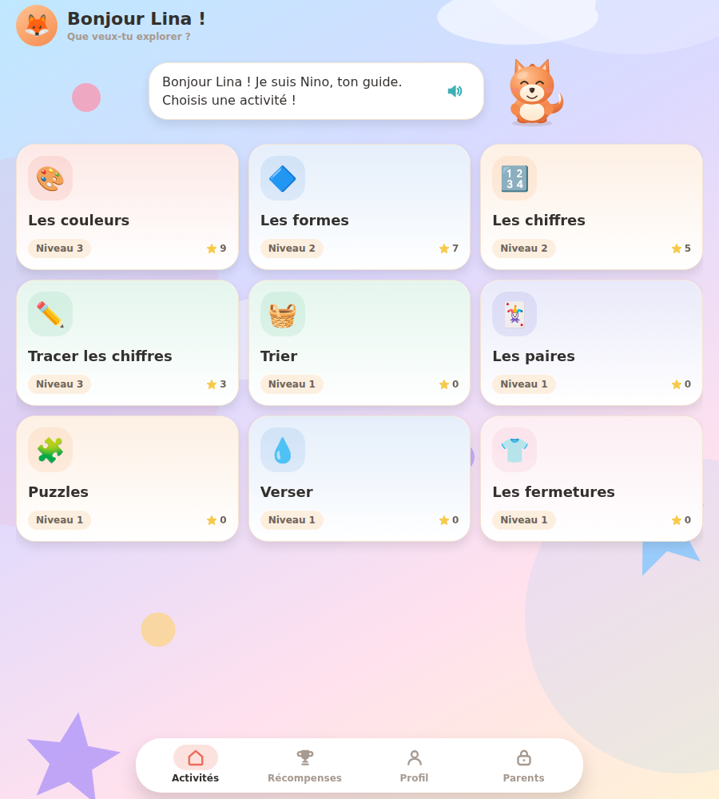
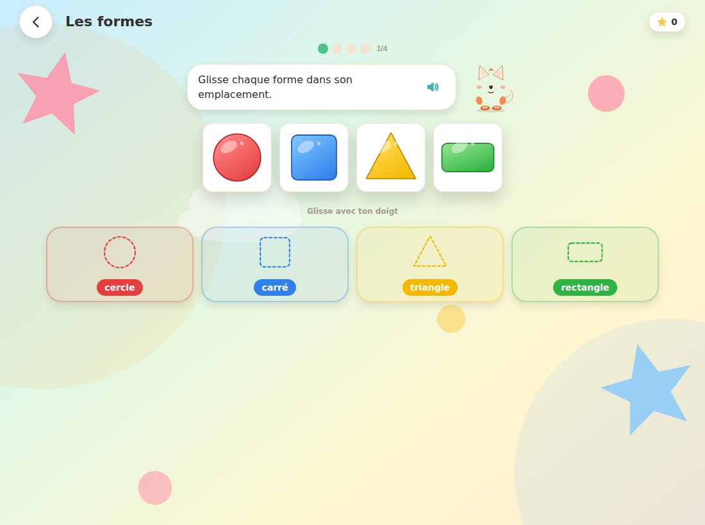
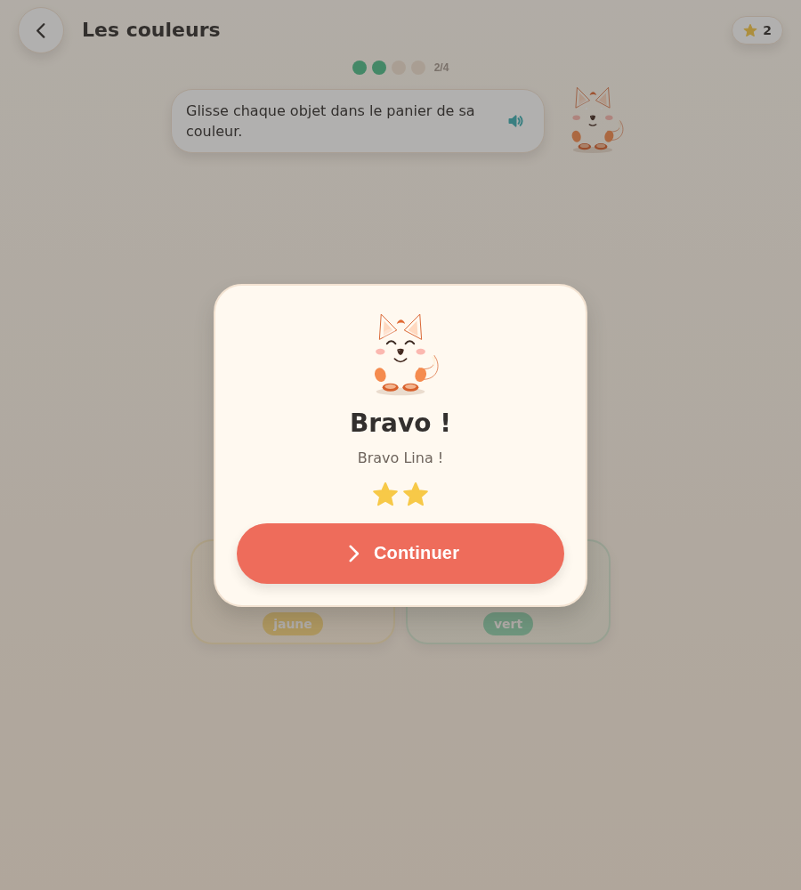
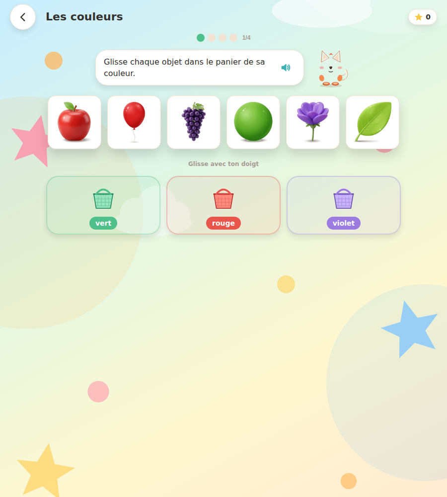
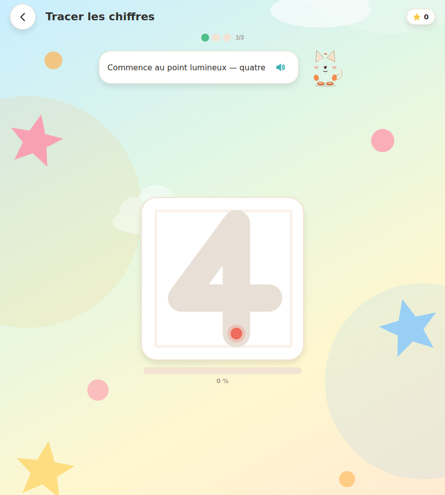
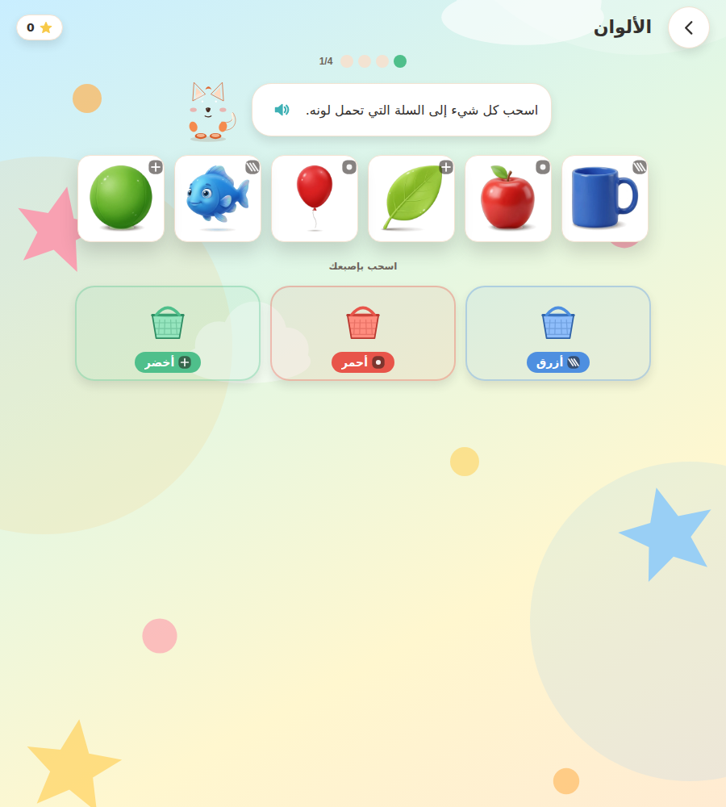

# 🦊 Montessori Club

Application éducative Montessori **0 – 12 ans**, multiplateforme (iOS · Android · Web)
à partir d'une **base de code unique** : Expo SDK 58, React Native 0.88, React Native Web, TypeScript strict.

> **Aucune publicité. Aucun achat. Aucune donnée personnelle collectée.**
> Tous les profils, progressions et réglages restent dans le stockage local de l'appareil.

---

## 🔗 Liens

| | |
|---|---|
| **Démo jouable (HTTPS, mobile & desktop)** | **[azharshahim.github.io/montessoriclub](https://azharshahim.github.io/montessoriclub/)** |
| **Dépôt GitHub** | [github.com/azharshahim/montessoriclub](https://github.com/azharshahim/montessoriclub) |
| **Intégration continue** | [Actions — déploiement Web](https://github.com/azharshahim/montessoriclub/actions/workflows/deploy-web.yml) |

> Le site est publié sur **GitHub Pages** par le workflow `.github/workflows/deploy-web.yml` :
> à chaque `git push` sur `main`, l'application est typée, compilée et redéployée automatiquement
> (≈ 3 minutes). Aucun serveur à maintenir.

---

## 1. Ce qui est livré dans cette version

| Domaine | Statut |
|---|---|
| Architecture complète + arborescence | ✅ |
| Socle : navigation, thème, i18n FR/EN/AR + RTL, profils, persistance | ✅ |
| **36 activités** réparties sur les 4 tranches d'âge | ✅ |
| Modules **0-2 ans** (5) : bulles, animaux, couleurs, formes à emboîter, xylophone | ✅ |
| Modules **3-5 ans** (9) : couleurs, formes, chiffres 1-10, tracé, trier, paires, puzzles, verser, fermetures | ✅ |
| Modules **6-8 ans** (10) : paires et puzzles, additions, soustractions, multiplications, syllabes, lecture, horloge, monnaie, sciences du vivant | ✅ |
| Modules **9-12 ans** (12) : fractions, géométrie, système solaire, monde, grammaire, conjugaison, code par blocs, équivalents, angles, temps, solides, carte du monde | ✅ |
| Espace parents protégé (progression, temps d'écran, profils, réglages) | ✅ |
| **Code parental à 4 chiffres**, verrouillage 30 s après 3 erreurs | ✅ |
| Récompenses : étoiles, badges, autocollants | ✅ |
| Mascotte guide 3D douce, voix off (synthèse), sous-titres | ✅ |
| Difficulté adaptative, auto-correction, sans chrono | ✅ |
| **Mode sombre** (automatique ou choisi), daltonisme, animations réduites, cibles ≥ 48 px | ✅ |
| **PWA** : manifeste, service worker versionné, installation, hors ligne | ✅ |
| Images réalistes des objets | ✅ 16 sur 16 (`assets/photos/objects/`) |
| Tests automatisés : typage, service worker, parcours complet clair + sombre | ✅ |

Les quatre tranches sont **jouables de bout en bout** : depuis la création du profil
jusqu'à la collection de récompenses, sans réseau ni compte.

### Nouveautés de la version 1.2

- **36 activités** contre 14 en v1.1 : les tranches 6-8 et 9-12 sont désormais complètes,
  avec les mêmes règles Montessori (une compétence par activité, erreur sans punition).
- **Mode sombre** lisible, réglable depuis l'espace parents (Automatique / Clair / Sombre).
- **Code parental à 4 chiffres** : défini, modifié ou supprimé par l'adulte. Sans code,
  la porte reste protégée par une multiplication à deux chiffres.
- **Installation et hors ligne** : service worker versionné, icônes maskables, écran de
  démarrage, cache des assets et repli sur `index.html` en navigation.
- **Banc d'essai automatisé** : le parcours complet (profils, 36 activités, manche
  d'addition, porte parentale, réglages, langue, réinitialisation) est rejoué en clair et
  en sombre avant chaque publication.

---

## 2. Stack technique

| Brique | Version | Rôle |
|---|---|---|
| Expo | `~58.0.16` | Build iOS/Android/Web, modules natifs |
| React / React DOM | `19.3.0` | UI |
| React Native | `0.88.0` | Rendu natif |
| React Native Web | `~0.21.4` | Rendu Web |
| TypeScript | `~5.9` | Typage strict |
| React Navigation (native-stack) | `7.x` | Navigation |
| Zustand + AsyncStorage | `5.x` / `2.2.0` | État global persistant |
| react-native-svg | `15.16.0` | **Toutes les illustrations** (aucun bitmap) |
| Reanimated | `4.7.1` | Particules de récompense |
| expo-audio / expo-speech | `58.x` | Sons et voix off |
| expo-haptics / expo-localization | `58.x` | Retour tactile, langue système |

**Choix structurants**

- *Vectoriel d'abord* : objets, formes, mascotte, icônes et paniers sont dessinés en SVG.
  Rendu net sur tous les écrans, aucune gestion de tailles @2x/@3x, poids minimal.
- *Voix off par synthèse native* : fonctionne hors ligne et sans téléchargement.
  La version « studio » (MP3 enregistrés) est décrite dans `docs/ASSETS.md`.
- *Tout local* : AsyncStorage uniquement, aucun backend, aucune télémétrie.

---

## 3. Démarrage en local

Prérequis : **Node 20+**, npm 10+, et Expo Go (téléphone) ou Xcode/Android Studio pour un build natif.

```bash
cd montessoriclub
npm install

# Lancer le serveur de développement (QR code pour Expo Go)
npm start

# Directement dans le navigateur
npm run web

# iOS / Android (avec simulateur ou appareil configuré)
npm run ios
npm run android

# Vérification TypeScript stricte
npm run typecheck

# Export Web statique (dossier dist/)
npm run build:web

# Contrôles complets : typage + service worker + parcours Web
npm run check

# Parcours uniquement, thème clair puis sombre
npm run test:web
DARK=1 npm run test:web

# Régénérer les sons (WAV, sans dépendance)
npm run sounds
```

> La première ouverture sur le Web peut nécessiter un clic : les navigateurs
> n'autorisent l'audio qu'après une interaction (règle d'autoplay).

---

## 4. Arborescence

```
montessoriclub/
├── App.tsx                     # Providers, hydratation, horloge de session
├── index.js                    # Entrée native (gesture-handler en premier)
├── app.json                    # Configuration Expo (iOS/Android/Web)
├── eas.json                    # Profils de build EAS
├── assets/
│   ├── images/                 # icône, icône adaptative, splash, favicon
│   └── sounds/                 # 8 effets WAV (générés par tools/)
├── src/
│   ├── audio/                  # moteur sonore, synthèse vocale, haptique
│   ├── engine/                 # difficulté adaptative, utilitaires
│   ├── games/
│   │   ├── types.ts            # contrat GameProps / GameModule
│   │   ├── useGameSession.ts   # boucle manches / étoiles / fin de session
│   │   ├── index.ts            # catalogue des activités
│   │   ├── colors/             # module couleurs
│   │   ├── shapes/             # module formes
│   │   ├── numbers/            # module chiffres
│   │   ├── tracing/            # module tracé au doigt
│   │   └── sensory/            # module éveil sensoriel (0-2)
│   ├── i18n/                   # FR / EN / AR, provider, RTL
│   ├── navigation/             # pile de navigation, types de routes
│   ├── screens/                # accueil, jeu, récompenses, parents…
│   ├── store/                  # profils + réglages (Zustand persist)
│   ├── theme/                  # palette, typographie, useTheme
│   └── ui/                     # design system (boutons, mascotte, plateau…)
├── tools/generate_sounds.py    # synthèse des 8 effets sonores
└── docs/                       # architecture, assets, publication, roadmap
```

Détail complet et flux de données : **`docs/ARCHITECTURE.md`**.

---

## 5. Les activités

### 0 – 2 ans — Éveil sensoriel
- 6 bulles flottantes, très gros boutons ; chaque éclatement = son doux + paillettes.
- Aucun objectif chiffré, aucune erreur possible, fin de session après 10 bulles.

### 3 – 5 ans
| Activité | Objectif unique | Progression |
|---|---|---|
| **Les couleurs** | Associer un objet à la couleur de sa corbeille | 2 → 4 couleurs ; ajout de teintes proches (rose/marron) |
| **Les formes** | Emboîter une forme dans son emplacement | 3 → 4 formes, puis doublons, puis cercle/ovale et carré/rectangle |
| **Les chiffres** | Dénombrer 1-10 et reconnaître le chiffre écrit | quantités 1-3 → 1-10, représentations en points |
| **Tracer les chiffres** | Suivre un tracé au doigt | 1-3 → 5 → 7-9 → 0-9 |

**Boucle de jeu** : 3 à 5 manches, mascotte qui énonce la consigne, auto-correction immédiate,
récompense en étoiles, bilan toujours positif.

### Vie pratique — gestes du quotidien
| Activité | Objectif unique | Progression |
|---|---|---|
| **Trier** | classer selon un seul critère | couleur → taille → famille (fruits, animaux) |
| **Les paires** | apparier deux images identiques | 3 → 4 → 6 → 8 cartes, deux manches |
| **Puzzles** | replacer chaque pièce à sa place | 2×2 → 3×2 → 3×3 → 4×3, fantômes de guidage |
| **Verser** | transvaser sans renverser | appui maintenu, zone cible qui se resserre |
| **Les fermetures** | réussir un geste de motricité fine | bouton → fermeture éclair → lacet |

### 6 – 8 ans

| Activité | Objectif unique |
|---|---|
| **Additions / soustractions / multiplications** | Calculer avec des quantités visibles, sans chrono |
| **Syllabes** | Recomposer un mot à partir de ses syllabes |
| **Lecture** | Associer un mot écrit à son image |
| **Horloge** | Lire l'heure (heures pleines, puis demies et quarts) |
| **Monnaie** | Composer une somme avec les pièces et billets |
| **Sciences du vivant** | Classer animaux et plantes, relier un être vivant à son milieu |
| **Paires / puzzles** | Reprendre les gestes de 3-5 avec plus de cartes et de pièces |

### 9 – 12 ans

| Activité | Objectif unique |
|---|---|
| **Fractions / équivalents** | Comparer des fractions et trouver des équivalences |
| **Géométrie / angles / solides** | Reconnaître les figures, mesurer les angles, nommer les solides |
| **Système solaire** | Ordonner les planètes et associer une planète à sa particularité |
| **Le monde / carte du monde** | Situer les continents, océans et pays sur une carte interactive |
| **Grammaire / conjugaison / temps** | Identifier la nature d'un mot, conjuguer, choisir le bon temps |
| **Code par blocs** | Construire une courte séquence d'instructions et l'exécuter |

Chaque activité se joue **sans chronomètre** : l'enfant peut recommencer autant de fois qu'il le
souhaite, un débordement ou un geste manqué n'enlève aucun point et ne bloque jamais la suite.
Les gestes acceptent aussi un simple toucher répété (accessibilité moteur et lecteurs d'écran).

---

## 6. Principes Montessori implémentés

- **Un objectif par activité** : chaque module ne demande qu'une seule compétence.
- **Manipulation** : glisser-déposer, toucher-sélectionner, tracé au doigt.
- **Erreur sans punition** : l'objet revient en place avec un son doux, la mascotte encourage.
- **Auto-correction** : la corbeille ou le point de passage valide le geste lui-même.
- **Progression adaptative** : 0 erreur → niveau +1 ; trop d'erreurs → niveau −1, sans message négatif.
- **Aucune pression temporelle** : pas de chronomètre ni de vies à perdre.
- **Autonomie** : profil en un toucher, relance d'activité sans passage par un menu.

---

## 7. Conformité, sécurité, accessibilité

- **Aucune publicité, aucun achat intégré**, aucun lien sortant dans l'espace enfant.
- **Aucune collecte** : ni compte, ni e-mail, ni analytics, ni identifiant publicitaire.
- **Espace parents protégé** par un code à 4 chiffres choisi par l'adulte (ou une
  multiplication à deux chiffres si aucun code n'est défini), verrouillé 30 s après 3 échecs.
  Le code est stocké localement en clair : c'est une protection contre les fausses manœuvres,
  pas un secret cryptographique — l'écran le précise.
- **RGPD-K / COPPA** : données stockées localement uniquement ; suppression d'un profil = effacement complet.
- **Accessibilité** : cibles ≥ 72 px (3-5 ans), contrastes AA, mode daltonisme
  (motifs + couleurs renforcées), option « réduire les animations », sous-titres de la mascotte.
- **Multilingue** : français par défaut, anglais, arabe (RTL appliqué au document Web).
  Toutes les chaînes passent par `src/i18n` ; la parité des clés est vérifiée par TypeScript.
- **Hors ligne** : tous les assets et les activités sont embarqués ; le service worker sert
  l'application depuis le cache et ne remplace jamais une requête non-GET.

Détail des formulaires stores et de la checklist de publication : **`docs/PUBLICATION.md`**.

---

## 8. Documentation

| Fichier | Contenu |
|---|---|
| `docs/ARCHITECTURE.md` | Arborescence commentée, flux de données, moteurs, extension |
| `docs/ASSETS.md` | Liste des assets + **prompts de génération**, charte graphique, script de voix |
| `docs/PUBLICATION.md` | Lancement local, EAS, App Store, Google Play, Web, conformité |
| `docs/ROADMAP.md` | Feuille de route détaillée des versions suivantes |
| `.github/workflows/ci.yml` | Contrôles automatiques sur chaque branche et pull request |

---

## 9. Licence et crédits

Code fourni comme base de production pour votre projet. L'icône mascotte de
`assets/images/icon-source.png` a été générée pour ce projet ; remplacez-la par
votre propre identité visuelle avant publication si nécessaire.

Polices : polices arrondies système (aucun téléchargement). Sons : synthèse originale.

---

## 10. Aperçu

| Accueil | Formes (paysage) | Récompense |
|---|---|---|
|  |  |  |

| Couleurs | Tracé au doigt | Arabe + daltonisme |
|---|---|---|
|  |  |  |

## 11. État de validation

| Contrôle | Résultat |
|---|---|
| `npx tsc --noEmit` (TypeScript strict) | ✅ 0 erreur |
| `npm run build:web` (`expo export`) | ✅ export complet + `dist/` |
| `npm run test:sw` | ✅ manifeste, icônes, précache, purge, navigation et assets hors ligne |
| `npm run test:web` (thème clair) | ✅ profils, 36 activités, addition, récompenses, édition de profil, porte parentale, réglages, langue, réinitialisation |
| `DARK=1 npm run test:web` (thème sombre) | ✅ mêmes parcours, fond sombre vérifié |
| FR / EN / AR + RTL, mode daltonisme | ✅ validés |
| Glisser-déposer, tracé au doigt, appui maintenu | ✅ validés par le parcours automatisé et les tests manuels |
